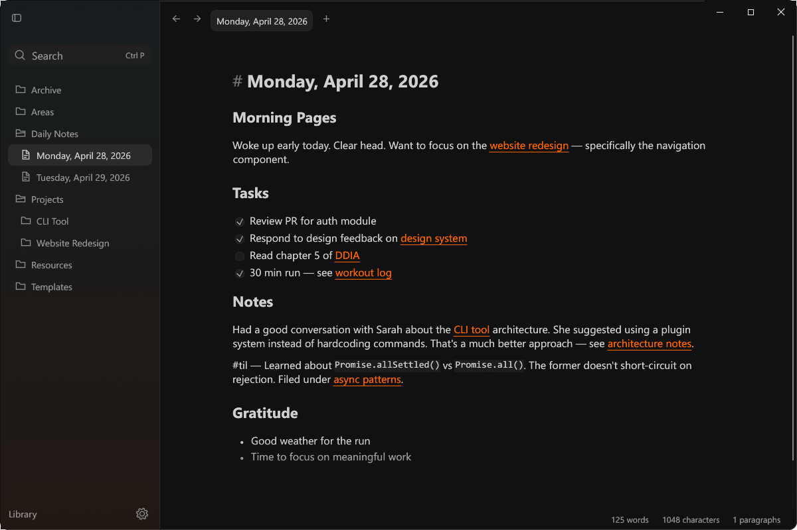
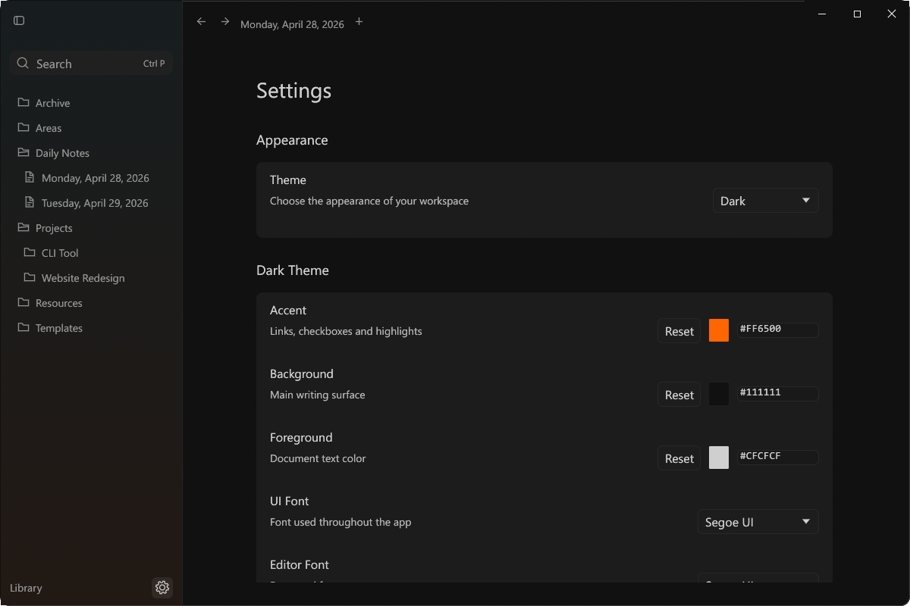
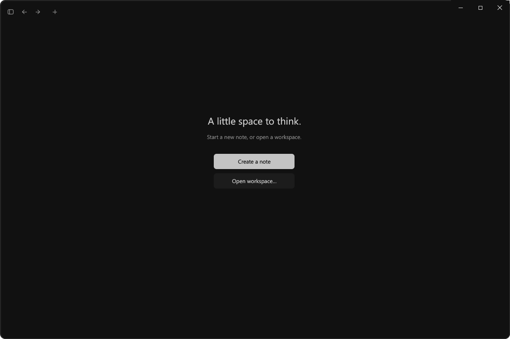
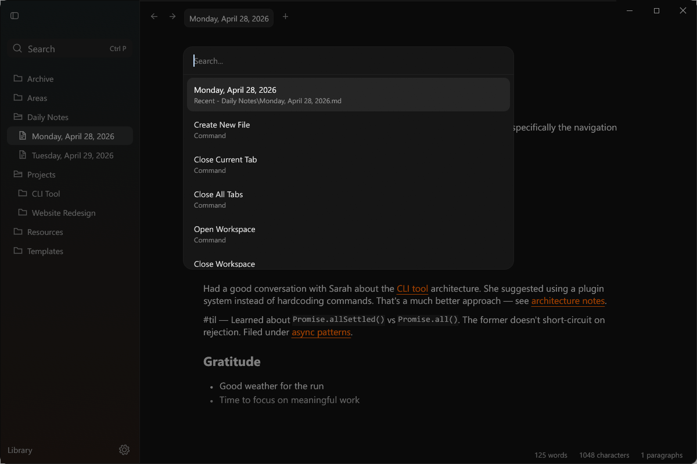
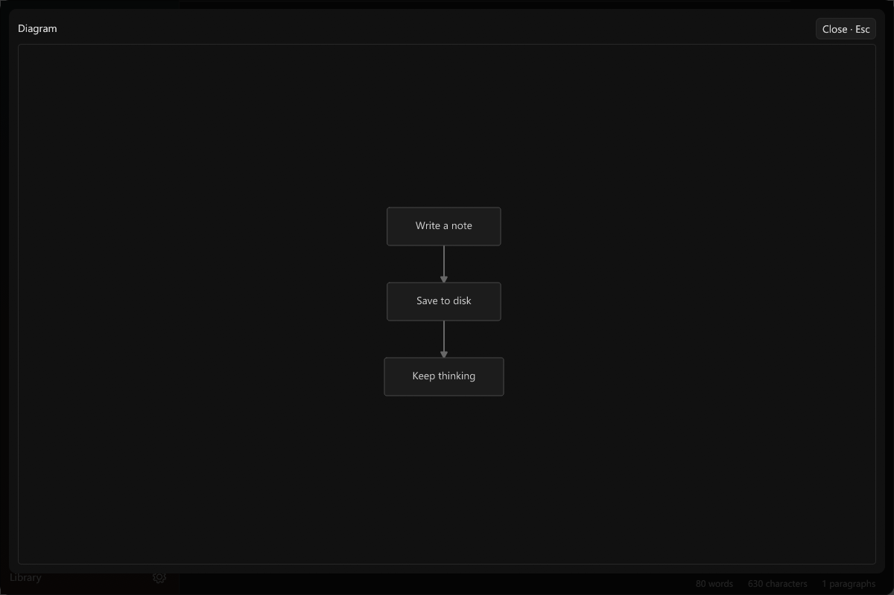

# Notes

A fresh native Windows Markdown app written in **Rust and egui**. Its visual
reference is [Writer](https://github.com/joelbqz/writer-computer) and the six
screenshots supplied for this project. No original app source was cloned,
installed, copied, or embedded. No Tauri, React, WebView, Node, or browser runtime
is required to run this app.

## Screenshots

Actual captures of the native Windows app running with sample notes.



| Settings | Welcome screen |
| --- | --- |
|  |  |

| Command search · Ctrl+P | Mermaid viewer |
| --- | --- |
|  |  |

Click any screenshot to view it at full size.

## Run

Build the project, then use `dist/Notes-Setup.exe` for a per-user installation,
or run `dist/Notes.exe` directly as a portable app. Setup creates a Start menu
shortcut and an uninstall entry. Its optional Markdown registration adds Notes
to **Open with**; choose your default app in Windows Settings.
The first launch opens an example vault under
`%LOCALAPPDATA%\WriterWindows\Example Vault` (the existing location is retained
for compatibility). To open your own folder, use the
Library context menu, Settings, or the **Open Workspace** palette command.

```powershell
cargo run --release
cargo run --release -- "C:\path\to\your\notes"
cargo run --release -- "C:\path\to\a note.md"
```

## Using the app

- Notes open in the clean rendered view, with clickable links, checkboxes,
  tables and diagrams. Press **F4** to write.
- Write in one continuous Markdown editor with styled headings, emphasis,
  links and code. Select and copy across paragraphs; use **Ctrl+Z** to undo and
  **Ctrl+Y** or **Ctrl+Shift+Z** to redo. Undo history and selections stay with
  each document when switching tabs.
- Editing now folds Markdown away from the active block and renders inactive
  paragraphs, lists, tables, images, math and diagrams in place. Click a block
  to edit its source. Rendered text can be selected and copied across paragraphs.
- Images support Markdown and `![[image.png]]` embeds. `[[Note|alias]]` links,
  extensionless note links and `#heading` links navigate locally. Inline `$...$`
  and display `$$...$$` math render natively; invalid formulas retain their source.
- **Ctrl+D** selects the current word and adds subsequent occurrences; typing
  replaces all selected occurrences in one undo transaction. **Alt+Up/Down**
  moves lines; **Alt+Shift+Up/Down** copies them. **Ctrl+Shift+K** deletes lines;
  **Ctrl+Enter** inserts a line below. **Ctrl+[/]** outdents/indents.
- **Ctrl/Shift-click** selects sidebar entries. Drag selected files/folders to
  another folder, a file's parent, or empty tree space (workspace root), or use
  **Move selected to…**. Colliding destinations are rejected before moving.
- **Ctrl+Shift+N** opens a workspace. Existing workspace windows are reused;
  files inside an open workspace route to that window. Other workspaces keep
  separate processes. Drag a tab away vertically, or use **Move tab to new window**
  in its context menu, to tear it off after saving. `--new-window` explicitly
  bypasses reuse. A standalone file starts compact; another routed file exposes tabs.
  **Ctrl+1–9** selects a tab in workspace windows.
- **Ctrl+B/I/K/E** applies bold, italic, link and inline code formatting.
  **Ctrl+Shift+X** toggles strikethrough; **Ctrl+Alt+1–6** changes headings.
  **Ctrl+Shift+8/7/Enter** toggles bullets, numbering and tasks.
  Enter continues lists; Enter on an empty item exits or outdents it.
  **Tab/Shift+Tab** indents/outdents selected lines.
- Press **F4** to switch between editing and rendered
  preview. Preview shows task checkboxes, tables and native diagrams. Clicking
  prose in preview opens the continuous editor at that block. **Escape** or **F4** returns to the clean view. Switching notes opens the clean view.
- **Ctrl+F** opens Find; **Ctrl+H** opens Find/Replace. Search highlights every
  match and keeps the active match visible. **F3/Shift+F3**, **Ctrl+G/Ctrl+Shift+G**
  or Enter/Shift+Enter in the Find field moves between matches. Match case and
  whole-word options are available. Enable **Regex** for regular expressions;
  replacements then support `$1` and `${name}` captures. Invalid patterns show an
  error. Literal mode keeps replacement strings literal. Both modes are undoable. **Escape** or Close returns to the
  view used before searching.
- Right-click a note or tab to **Pin note**. Pinned and recent notes appear in an
  empty **Ctrl+P** palette. The optional sidebar sections can be hidden in Settings.
  Pins and the last 20 opened notes persist and follow renames/moves.
- **Ctrl+P** finds note names, note contents, and commands. A leading `>` limits
  the palette to commands. Arrow keys select; Enter opens; Escape dismisses.
- **Ctrl+N** creates a note, **Ctrl+T** opens the note picker, **Ctrl+W** closes a
  tab, and **Ctrl+Tab/Ctrl+Shift+Tab** selects the next/previous tab. Middle-click
  a tab to close it. Scroll over the tab row with a mouse wheel or trackpad
  to reach more tabs; the tab scrollbar is hidden.
- **Alt+Left/Right** navigates document history. **Ctrl+\\** toggles the sidebar.
- The gear beside Library opens Settings; **Ctrl+,** also opens it. Change colors, fonts, editor size, width, zoom,
  top padding, and sidebar tint. Settings and the open-note session persist.
- Right-click a sidebar entry to rename, reveal it in Explorer, create a child
  note, or move a note to Archive. Existing files are never replaced by create
  or rename operations. **Delete note** in a sidebar or tab context menu moves
  the note to the Windows Recycle Bin, where you can restore it.

Edits autosave on a background worker after a short pause. Note loading and
conflict resolution also run off the UI thread. Typing during a save remains
dirty until saved; closing waits for pending saves and cancels on failure.
External edits reload when a note is clean.
Notes soften into a progressive blur and fade at the bottom of the writing area,
in both themes. The scrollbar and status bar stay sharp; typing and keyboard
navigation keep the caret above the faded edge.
If a changed note conflicts with the disk version, Notes preserves a
`<full-note-filename>.writer-recovery` copy. On restart, a recovery review shows
the disk version beside the draft, including drafts excluded by `.gitignore`.
Reviewing leaves the disk version untouched. Choose **Keep disk version**,
**Keep my draft**, or **Save copy and close** to resolve a conflict explicitly.
Renames retain Markdown extensions and support case-only changes on Windows.
Renames and moves update resolvable Markdown/wiki/image references in the
workspace inventory, preserving aliases, headings and code examples.
The workspace tree respects `.gitignore` and skips symlinks. No telemetry is
implemented.

Mermaid diagrams render through the native Rust `mermaid-rs-renderer` library
and SVG rasterization; there is no JavaScript execution. Right-click a diagram
to edit its source. The diagram toolbar provides zoom, fit, source and fullscreen;
drag to pan, pinch to zoom, or focus the canvas and use arrows and +/−/0.
Unsupported or invalid syntax displays an error. Filesystem watching, indexing
and content search run on a worker; palette results include matching snippets.

Images show loading and error states with retry/source actions. Click an image
to open the full-window viewer, then zoom, pan, fit or press Escape to close.
Large tables cache their structure and lay out only visible rows with overscan.
Initial column fitting samples up to 128 rows; measured row heights settle as
you scroll. Drag column dividers to resize or
double-click to reset. Code blocks preserve tilde fences and indentation.
Math supports dollar and LaTeX bracket delimiters, with natural-sized display
formulas and visible errors. Both themes share adaptive controls and code colors;
bold headings follow the chosen editor font. Whole-document reference definitions
resolve in isolated rich blocks. Bare equation/align/gather/multline environments
and their starred variants render in preview; source stays unchanged. Starred
variants use unnumbered aligned rows. Mermaid accepts mixed-case fence labels,
`{.mermaid}` fences, and bounded init nodeSpacing/rankSpacing values. Rich-block
source opens at its clicked screen height while fold measurements settle.

## Build and validate

Requires Rust with the Windows MSVC target and Visual Studio C++ build tools.

```powershell
cargo test --locked
cargo clippy --all-targets --locked -- -D warnings
cargo fmt --all -- --check
powershell -ExecutionPolicy Bypass -File scripts/build.ps1 -Check
```

The build script produces `dist/Notes.exe`, `dist/Notes-Setup.exe`,
`dist/Notes-Windows.zip`, and `dist/SHA256SUMS.txt`. Add `-SignThumbprint` with a
valid local code-signing certificate to sign both executable outputs. The default
build and CI artifacts are unsigned. See [Windows distribution](docs/DISTRIBUTION.md).

Settings checks GitHub releases once a day by default; disable this in Updates.
Automatic download/install is opt-in. Downloads require GitHub's SHA-256 asset
digest, size limits, and the expected repository URL. Updates wait for saves and
other Notes windows, keep an executable backup, and verify publisher continuity
when the installed executable has a valid signature. No release is created by
an ordinary branch push; matching `v<version>` tags publish release assets via CI.
The executable uses the Windows system fonts without redistributing them.

## Parity status

This is a working native implementation, **not certified as a 100% pixel-identical
or feature-complete port**. See [the verification and differences record](docs/VERIFICATION.md).
The screenshot-based shell, notes, tabs, tasks, tables, palette, settings and
diagrams are implemented. macOS wallpaper blur is approximated by a painted
sidebar tint; Windows font rasterization differs. The app uses a continuous editor
with native syntax folding and rich widgets while retaining an optional rendered
view. See [the eight-feature implementation record](docs/PARITY_FEATURES.md)
for the behavior, checks and limits.

GPL-3.0-only. See [LICENSE](LICENSE). Original product reference: joelbqz/Writer.
